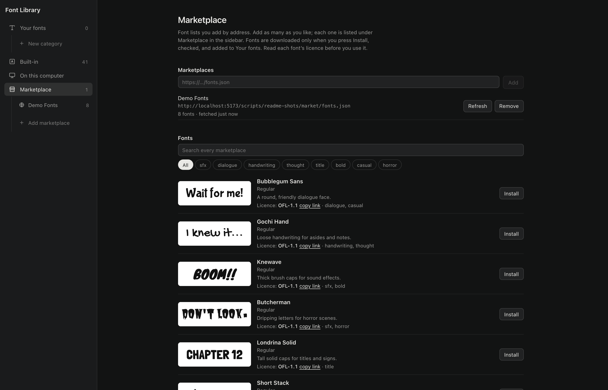

# Font marketplace guide

A font marketplace is a list of fonts that anyone can add to Pear. You make
one JSON file, put it on the web with your font files, and share the link.
People paste the link into Pear and install fonts with one click.

There is no server to run and no account with us. Any place that can serve a
file over `https://` works.



## How it works

1. You write `fonts.json`. It lists each font, its licence, and where its
   files are.
2. You upload `fonts.json`, the font files and (optional) preview images to
   any static host.
3. A user opens **Font library** (the **T** button at the top right of the
   editor), goes to **Marketplace**, pastes your `fonts.json` link and presses
   **Add**.
4. They press **Install** on a font. Pear downloads the files, checks them,
   and adds the font to **Your fonts**.

Pear only fetches your list when the user adds it or presses **Refresh**. It
downloads a font only when the user presses **Install**.

## 1. Make the folder

```
my-fonts/
├── fonts.json
├── files/
│   ├── LetteringPal-Regular.ttf
│   └── LetteringPal-Bold.ttf
└── previews/
    └── lettering-pal.png
```

Only share fonts whose licence lets you give them away (for example the
[SIL Open Font License](https://openfontlicense.org)). Paid or "personal use"
fonts usually do not allow this.

## 2. Write `fonts.json`

The smallest useful file:

```json
{
  "format": "pear-font-market",
  "version": 1,
  "name": "My Fonts",
  "fonts": [
    {
      "id": "lettering-pal",
      "family": "Lettering Pal",
      "license": { "name": "OFL-1.1", "url": "https://openfontlicense.org" },
      "files": [{ "url": "files/LetteringPal-Regular.ttf", "style": "Regular" }]
    }
  ]
}
```

A fuller entry:

```json
{
  "id": "lettering-pal",
  "family": "Lettering Pal",
  "designer": "Your Name",
  "description": "A casual dialogue face.",
  "license": { "name": "OFL-1.1", "url": "https://openfontlicense.org" },
  "preview": "previews/lettering-pal.png",
  "tags": ["dialogue", "casual"],
  "files": [
    { "url": "files/LetteringPal-Regular.ttf", "style": "Regular", "sha256": "…", "size": 47292 },
    { "url": "files/LetteringPal-Bold.ttf", "style": "Bold" }
  ]
}
```

File addresses can be relative (`files/x.ttf`). Pear reads them from the same
place as `fonts.json`.

### Top level

| Field | Need it? | What it does |
| --- | --- | --- |
| `format` | no | Must be `"pear-font-market"` if you write it. |
| `version` | no | `1`. |
| `name` | no | The name shown in Pear. Without it, Pear shows the host name. |
| `description` | no | One or two sentences. |
| `homepage` | no | An `https://` link. |
| `updated` | no | A date, shown as you write it. |
| `fonts` | **yes** | The list of fonts (up to 5000). |

### Each font

| Field | Need it? | What it does |
| --- | --- | --- |
| `id` | **yes** | A short unique name, like `lettering-pal`. |
| `family` | **yes** | The font name in Pear. It must not be the name of a font Pear already has built in. |
| `license` | **yes** | `{ "name": "OFL-1.1", "url": "https://…" }`, or just `"OFL-1.1"`. A font with no licence is skipped. |
| `files` | **yes** | The font files (see below). |
| `designer` | no | Shown under the name. Search finds it. |
| `description` | no | Shown under the name. |
| `preview` | no | A PNG, JPEG, WebP or SVG of the font. |
| `tags` | no | Up to 16 short words, like `sfx` or `dialogue`. Users filter by them. |

### Each file

| Field | Need it? | What it does |
| --- | --- | --- |
| `url` | **yes** | Where the file is. |
| `style` | **yes** | `Regular`, `Bold`, `Italic` or `Bold Italic`. One file per style. |
| `sha256` | no | The file's checksum. Pear refuses a download that does not match. |
| `size` | no | The file size in bytes. Pear refuses a download of another size. |

Pear takes `.ttf`, `.otf`, `.ttc`, `.woff` and `.woff2`, up to 64 MB each.

Other weights (Light, Black, …) have no style slot. List each one as its own
font, for example `"family": "Lettering Pal Light"`.

To get `sha256` and `size` on macOS or Linux:

```bash
shasum -a 256 files/LetteringPal-Regular.ttf
```

```bash
wc -c < files/LetteringPal-Regular.ttf
```

### Preview images

The preview box in Pear is 3 wide by 1 tall. A 504 × 168 PNG of a short
phrase, dark letters on white, looks best. Without a preview, Pear shows the
font name in plain text.

## 3. Test it on your computer

Pear accepts plain `http://` only for your own computer. Start a small web
server in the folder:

```bash
cd my-fonts && python3 -m http.server 8000
```

Then add `http://localhost:8000/fonts.json` in Pear. If a font has a problem,
Pear skips it and shows why under the marketplace (for example "no licence").
The rest of the list still loads.

## 4. Put it online

Pick one. All are free for a small font list.

### GitHub Pages

1. Make a public GitHub repository and push the `my-fonts` folder contents.
2. In the repository, open **Settings → Pages**. Set the source to your main
   branch, root folder.
3. Your link is `https://<user>.github.io/<repo>/fonts.json`.

### GitHub without Pages

Push the folder to a public repository and use the raw file link:

`https://raw.githubusercontent.com/<user>/<repo>/main/fonts.json`

Changes can take a few minutes to show.

### Cloudflare Pages or Netlify

Drag the `my-fonts` folder into a new site on
[Cloudflare Pages](https://pages.cloudflare.com) or
[Netlify Drop](https://app.netlify.com/drop). Your link is the site address
plus `/fonts.json`.

### Your own server or storage bucket

Any web server, or a public bucket (Cloudflare R2, Amazon S3, …), works.
Upload the folder and use the `https://` link to `fonts.json`.

## 5. Share the link

Give people the `fonts.json` link. That is all they need.

To update the list, change `fonts.json` and upload it again. Users get the
new list when they press **Refresh**.

## Rules Pear checks

- Every link must be `https://`. Plain `http://` works only for `localhost`,
  `127.0.0.1` and `[::1]`.
- Links with a user name or password in them are refused.
- Redirects are followed only to other `https://` links.
- `fonts.json` can be at most 4 MB.
- Your host does not need CORS headers. The desktop app downloads with its
  own code, not the web view.
- A downloaded file must really be a font, match `sha256` and `size` when you
  give them, and load. A file that fails is not installed, and Pear says why.
- An installed font belongs to the user from then on. They can rename, move,
  switch off or remove it like any font they added by hand.

The code that reads the list is `parseManifest` in
[`src/lib/font-market.js`](src/lib/font-market.js).
