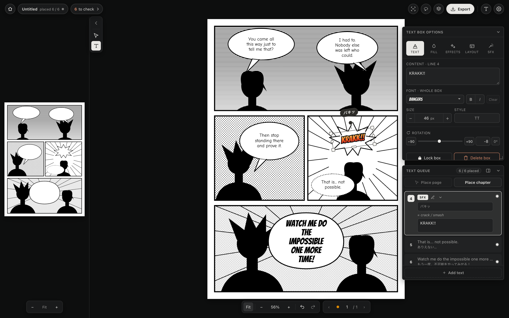
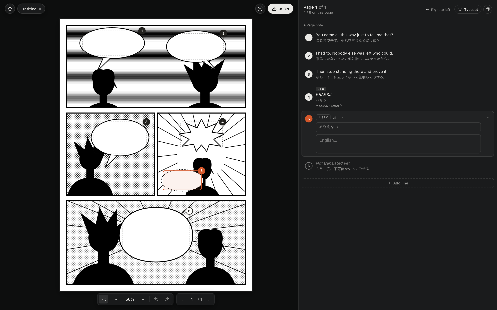
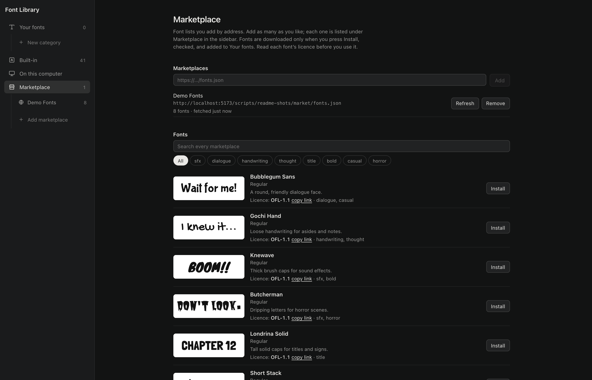

<div align="center">

<pre>
█▀█ █▀▀ ▄▀█ █▀█
█▀▀ ██▄ █▀█ █▀▄

lettering for scanlation, without Photoshop
</pre>

[](#install)
[](#install)
[](#install)
[](https://typesetter.komiq.cc)
[](LICENSE.md)
[](https://discord.gg/vhuYWbZNX5)
[](https://ko-fi.com/komiq)

</div>

**Pear** is a desktop app for putting translated text into manga and comic
speech bubbles. It finds the bubbles, reads the original text, and places
your translation in them. Then you style it. No Photoshop needed.

**[Download](https://typesetter.komiq.cc)** · **[User guide](HOWTO.md)** · **[Font marketplace guide](FONT_MARKETPLACE.md)**

> Public beta. People use it every day, but expect rough edges.



## How it works

1. **Add pages.** Drop in a chapter. Pear finds the text bubbles and reads
   the Japanese, Chinese or Korean text.
2. **Translate.** Type the English next to each numbered bubble. Tag each
   line (dialogue, thought, SFX, …).
3. **Typeset.** Pear puts each line in its bubble and fits it. Each tag has
   its own font and style, so most lines need no work.
4. **Polish and export.** Fix the few lines that need it, add effects to
   sound effects, and export the pages.



## Features

**Getting the text in**

- **Bubble detection and OCR.** Finds text bubbles and reads Japanese,
  Chinese and Korean. Runs on your GPU when it can.
- **Translate view.** Bubbles are numbered on the page. You type in a pane
  beside it, one line per bubble.
- **Auto placement.** Each line goes into its bubble and is sized to fit.
  Turn it off in Settings, or per bubble.

**Styling**

- **Tags.** Give a tag a font and look once. Every line with that tag uses
  it. Tags are saved per series.
- **Bulk restyle.** Change every box with a tag, or every selected box, at
  once.
- **Fills.** Solid colour, gradient, or pattern (screentone).
- **Effects.** Strokes, shadows, glow and bevel (like Photoshop layer
  styles), warp, arcs and curves, liquify, blur and motion blur, rough
  edges, and special effects like cracks and lightning.
- **Sound effects.** SFX tools with 12 sound types that lay out and size the
  letters for you.

**Fonts**

- **Font library.** Add your own fonts, sort them into categories, and turn
  fonts on or off in the menus.
- **Font marketplaces.** Add a font list by its link and install fonts with
  one click. Anyone can host one: see the
  **[font marketplace guide](FONT_MARKETPLACE.md)**.

**Everything else**

- **Export** to PNG, JPG, WebP or JSON, per page or per chapter.
- **Autosave**, undo for every edit, and snapshots before risky changes.
- **Shortcuts** for every action, all rebindable.
- **Light on memory.** Works through hundreds of pages and keeps heavy data
  on disk.
- **Auto updates**, signature-checked.
- **AI helper (optional).** Bring your own Claude API key to let it place and
  style text for you.

> **Do not use PSD export yet.** It is not finished.



## Install

Get the installer from **<https://typesetter.komiq.cc>**.

- **macOS (Apple Silicon):** open the `.dmg` and drag Pear to Applications.
  The app is not notarised yet, so the first time, right-click it and choose
  **Open**.
- **Windows:** run the setup `.exe`.
- **Linux (x86_64 or ARM64):** install the `.deb`, or make the `.AppImage`
  executable and run it. Pick the file for your CPU.

Updates arrive inside the app.

<details>
<summary><b>Linux notes</b></summary>

- You need **glibc 2.39 or newer**: Ubuntu 24.04, Mint 22, Fedora 39,
  Debian 13, Arch, or newer. Check with `ldd --version`. On older systems the
  app stops with `version 'GLIBC_2.39' not found`.
- Both builds use your system's GTK 3 and WebKitGTK 4.1. The `.deb` installs
  them. The AppImage tells you the command if they are missing
  (`libwebkit2gtk-4.1-0` on Debian and Ubuntu, `webkit2gtk4.1` on Fedora,
  `webkit2gtk-4.1` on Arch).
- The x86_64 build uses your GPU through Vulkan (WebGPU) when it can, and the
  CPU when it cannot. It runs on every x86-64 CPU, including ones without AVX.
- The ARM64 build uses the CPU only.
- Each Linux build only updates to its own kind (`.deb` to `.deb`, AppImage
  to AppImage).

</details>

## Build from source

You need [Node](https://nodejs.org) 20+ and [Rust](https://rustup.rs) (see
the [Tauri v2 prerequisites](https://v2.tauri.app/start/prerequisites/)).

```sh
git clone https://github.com/komiq-cc/manga-typesetter.git
cd manga-typesetter
npm install

npm run tauri dev     # run it
npm run tauri build   # make installers in src-tauri/target/release/bundle
npm test              # run the tests
```

Detection models are not in the app. They download the first time you use
them. Pick the Chinese and Korean readers in **Settings → Detection**.

<details>
<summary><b>GPU details</b></summary>

Detection and OCR use the GPU when they can, and fall back to the CPU per
model. Settings shows which device is in use.

- **macOS:** CoreML.
- **Windows:** CUDA on NVIDIA with CUDA 13 and cuDNN 9 installed, otherwise
  DirectML (any GPU, nothing to install).
- **Linux:** WebGPU over Vulkan (any GPU), CPU when there is no usable
  driver. A CUDA build exists for NVIDIA with CUDA 13 + cuDNN 9:

  ```sh
  npm run tauri build -- --features gpu-cuda --config src-tauri/tauri.linux-cuda.conf.json
  ```

  Plain `cargo build` on Linux has no GPU provider. Pass
  `--features gpu-webgpu` or `gpu-cuda`, not both. The WebGPU feature needs
  glibc 2.38+ and GCC 13's libstdc++ (Ubuntu 24.04 or newer).

To force a device when a driver misbehaves, set `MT_DEVICE=cpu` (or `cuda`,
`directml`, `webgpu`, `coreml`) before you start the app. The first device
check runs in a helper process (`app --probe-device`), so a crashing driver
only stops the helper, and detection stays on the CPU.

With the NVIDIA driver on Linux, the app turns off WebKit's DMA-BUF renderer
(the window is blank otherwise). Set `WEBKIT_DISABLE_DMABUF_RENDERER=0` to
turn it back on.

The AppImage uses your system's GTK and WebKit, like the `.deb`.
`scripts/build-appimage.sh` explains why.

</details>

## Built with

[Svelte 5](https://svelte.dev) · [Vite](https://vite.dev) ·
[Tauri 2](https://tauri.app) · [ag-psd](https://github.com/Agamnentzar/ag-psd) ·
[hypher](https://github.com/bramstein/hypher) ·
[ONNX Runtime](https://onnxruntime.ai) via [`ort`](https://ort.pyke.io)

Detection models from
[deepghs/manga109_yolo](https://huggingface.co/deepghs/manga109_yolo) and
[kha-white/manga-ocr](https://github.com/kha-white/manga-ocr), plus PP-OCRv4/v5
Korean and PP-OCRv5/v6 Chinese readers published by
[RapidOCR](https://github.com/RapidAI/RapidOCR). No model weights ship in the
app. They download on first use from a byte-for-byte RapidOCR mirror, and
each keeps its publisher's own terms.

## License

[MIT](LICENSE.md) © 2026 k-omiq

Third-party licenses and notices are in [THIRD-PARTY.md](THIRD-PARTY.md).
